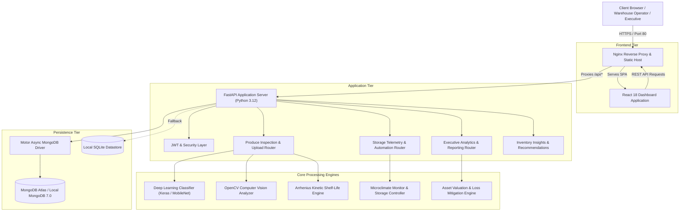

# System Architecture & Technical Specifications

**AI-Powered Food Freshness Monitoring Platform**

---

## 1. High-Level Architecture Overview

The platform uses a decoupled microservices-ready architecture comprising a single-page React frontend, an asynchronous FastAPI application server, a computer vision and deep learning inference pipeline, a kinetic decay calculation engine, and a dual-tier storage strategy (MongoDB Atlas with SQLite local fallback).

---

## 2. Core Subsystems

### 2.1 Deep Learning Classification Pipeline
- **Model Framework:** TensorFlow 2.17+ / Keras 3.
- **Backbone Architecture:** MobileNetV2 / Custom Convolutional Neural Network pretrained on ImageNet and fine-tuned on multi-class fresh and rotten produce datasets.
- **Classes Supported:** `freshapples`, `rottenapples`, `freshbanana`, `rottenbanana`, `freshoranges`, `rottenoranges`, `freshcotton`, `rottencotton`, etc.
- **Inference Mode:** Automated fallback mechanism loads `.keras` or `.h5` model weights; if running in lightweight development environments without native TensorFlow C-bindings, a deterministic statistical heuristic simulator activates to preserve continuous API uptime.

### 2.2 Computer Vision Analysis Module ([`image_analyzer.py`](file:///d:/info_project/backend/app/image_analyzer.py))
Extracts objective physical freshness features from produce imagery:
1. **Color Space Variance:** Converts RGB images into HSV color space to isolate the Hue and Saturation distributions. Computes the percentage of dark or brown pixel patches indicative of oxidation and enzymatic browning.
2. **Texture Uniformity & Entropy:** Evaluates surface roughness and skin degradation using grayscale gradient operators and Laplacian variance.
3. **Visual Quality Score ($Q_v$):** Scaled index from $0$ to $100$ integrating detected rot class, browning area ratio, and texture degradation.

### 2.3 Kinetic Shelf-Life Engine ([`shelf_life_engine.py`](file:///d:/info_project/backend/app/shelf_life_engine.py))
Shelf life degradation is governed by fundamental biochemical kinetics rather than static countdowns:
- **Arrhenius Reaction Velocity:**
  $$\ln\left(\frac{k_T}{k_{ref}}\right) = \frac{E_a}{R}\left(\frac{1}{T_{ref}} - \frac{1}{T}\right)$$
- **$Q_{10}$ Temperature Quotient Simplification:**
  $$\text{Degradation Multiplier } M_T = Q_{10}^{\frac{T - T_{opt}}{10}}$$
  where $Q_{10} \in [1.8, 2.5]$ depending on commodity respiration rate.
- **Relative Humidity ($RH$) Penalty:**
  $$M_{RH} = 1 + \max\left(0, \frac{|RH - RH_{opt}| - 5}{100}\right) \times \gamma$$
  High humidity accelerates fungal growth, while low humidity drives moisture transpiration and shriveling.
- **Chilling Injury Threshold:** Tropical commodities (e.g., Bananas) trigger physiological necrosis warnings when stored below their critical threshold ($12^\circ\text{C}$).
- **Net Remaining Shelf-Life:**
  $$SL_{remaining} = \max\left(0, \frac{SL_{base} \times (Q_v / 100)}{M_T \times M_{RH}}\right)$$

### 2.4 Storage Microclimate Monitoring ([`storage_monitoring.py`](file:///d:/info_project/backend/app/storage_monitoring.py))
- Tracks multiple simulated IoT zones (e.g., `Zone-A: Cold Storage`, `Zone-B: Ripening Chamber`, `Zone-C: Ambient Loading Dock`).
- Real-time telemetry evaluates excursion risks and triggers automated compensation routines (e.g., automated cooling boosts when temperature drifts $+2^\circ\text{C}$ above setpoint).

### 2.5 Executive Analytics Engine ([`executive_analytics.py`](file:///d:/info_project/backend/app/executive_analytics.py))
- Computes aggregated enterprise portfolio metrics:
  - Total Active Inventory Valuation ($\$$).
  - Prevented Spoilage Loss ($\$$) via dynamic clearance pricing and cold-chain reallocation.
  - Landfill Diversion and Carbon Avoidance ($\text{kg CO}_2\text{e}$).
  - HACCP/ISO 22000 regulatory audit scoring and compliance verification.

---

## 3. Security, Authentication & Data Flow

1. **Authentication:** Stateless JSON Web Token (JWT) using HS256 encryption. Token exchange occurs via `/auth/token` with secure password hashing via `passlib` (PBKDF2/Bcrypt).
2. **Access Control:** Role-Based Access Control (RBAC) separates warehouse floor operators, quality inspectors, and executive auditors.
3. **CORS & Network Isolation:** FastAPI CORS middleware restricts API requests to authorized origins, while Nginx reverse proxy isolates the internal backend port from direct external exposure.
4. **Data Redundancy:** Asynchronous Motor driver connects to cloud-hosted MongoDB Atlas. If network partitions or cluster unavailability occur, the backend automatically transitions to an embedded SQLite datastore without interrupting inspection workflows.
